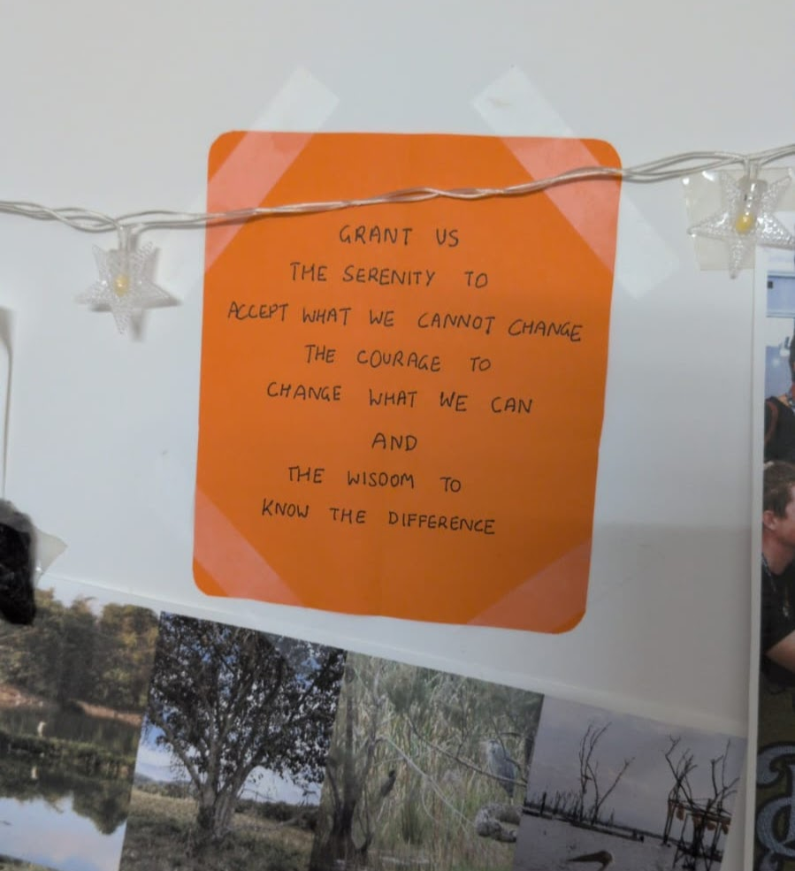

## Thursday

Thursday is my newest project. I'm experimenting with ways to make building 
software fun again, using AI and the internet to shorten the feedback loop 
between developer and user.

The first experiments are deliberately simple - right now I'm trying to gather 
data about how other devs think and work, to build solutions that work for 
myself and hopefully them.

[Try it today](https://trythursday.org)

It all started when my last job kinda... evaporated, overnight, due to some 
funding troubles.

I was completely lost. It felt like an unraveling of who I was, for a little -- 
I hadn't realised how much importance I attached to my job, that superpower of 
being able to sit down, write code, and make my life better.

Coding used to be incredibly fun. I sank hours and hours everyday into coding 
even before I ever knew it was something I could make money doing. At my 
previous job, towards the end, something had changed for me. The coding wasn't 
fun anymore. I enjoyed working with my team. The perks were unbeatable. 
_Why wasn't I having fun anymore?_

At first I thought that having been researching Nostr and Bitcoin for so long 
for my job, what would help me was going back to basics - building something all
for my own.

[DeepSeek Harness](https://www.deepseek.com/en/harness/) had just come out. I 
was fascinated, since I had spent a long time by now building plugin systems. I 
worked on a complicated DeepSeek Harness distribution with a ticket board and 
lots of quality of life improvements. I vibe coded the whole thing, spending 
hundreds of dollars in AI credits. _Why was it still not fun?_

I coded and I coded and I coded. I was still nowhere close to done. I bought a 
domain, thinking that would create some pressure for me to finish the thing and 
put something online. Still no luck.

After enough introspection, and feeling like I had quite literally hit rock 
bottom, I realised that there was a big incentive misalignment here. I was 
treating the code as if it was the important part, but what I really wanted to
experience again was the joy of building. The instant feedback I used to get 
from writing code and watching something pop up on screen.

It wasn't the money that was the superpower. The superpower was simply to build.

But I still wanted to use AI! I would fall behind my peers and colleagues if I
didn't - there's no denying that AI is a force multiplier.

What I realised I wanted was an AI agent that just _did what I said_. Claude was
not it. DeepSeek Harness was not it.

I just had to put on my crew-resource-management goggles - What did I do best?
Think about software. What did the LLM do best? Transform text from one form
into another.

After hundreds of dollars and thirty thousand lines of code, the first version 
of the coding agent Thursday ended up being a skill file. The goal: make vibe
coding fun again.

Suddenly, coding was fun again. And I was spending less than $20 a month on AI 
inference, enabled by the absolute GOATs - DeepSeek v4 Flash and GLM 5.3.

## Serenity

I've been thinking a lot about Andreas Kling. Fresh out of rehab in Sweden, he 
[decided to write](https://awesomekling.github.io/I-quit-my-job-to-focus-on-SerenityOS-full-time/) a toy operating system, simultaneously a love letter to 90s UX,
to keep away from falling into his old patterns.

Today, SerenityOS is very much a "serious project" and it even spawned a web 
browser, Ladybird. A competitor to the Chromium-Firefox duopoly! It inspired 
others to enter the field. All of that from one man's desire to improve himself 
and his life.

I am a boundlessly optimistic person. I believe we can make coding fun again. I
believe we can build systems to responsibly use AI. I think we can correct the 
incentive misalignment the entire software industry is currently suffering from.

Thursday is my bet on that - a project to fix the world, by making coding fun
again, just for myself.

Hence, a SerenityOS for myself.

---

Spend 5 minutes trying the skill file. Paste in your coding agent:

> I want to try the Thursday skill from https://github.com/trythursday/thursday.

Type `/thfeedback` at any time to tell me what you think. This is where the 
revolution starts.
