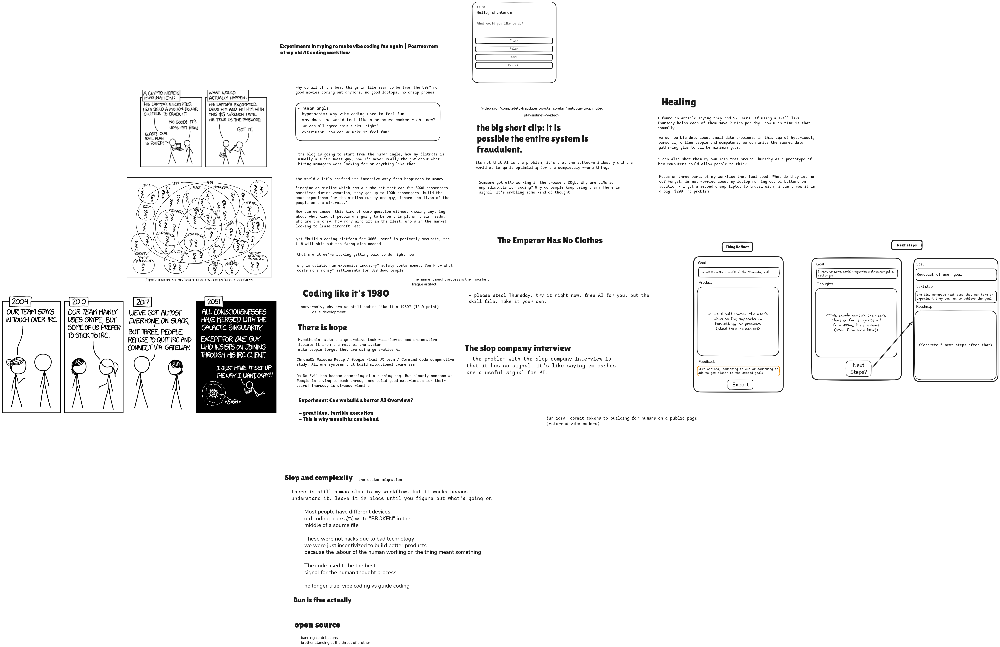
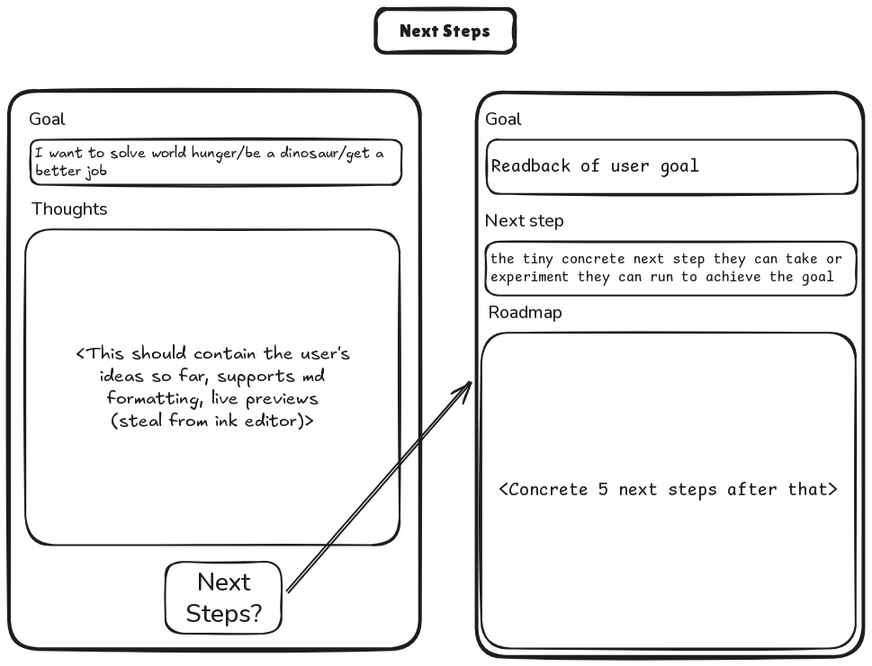
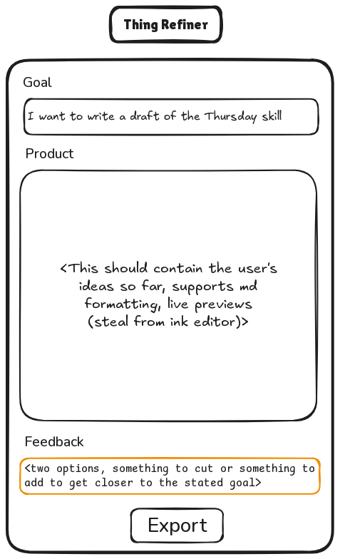
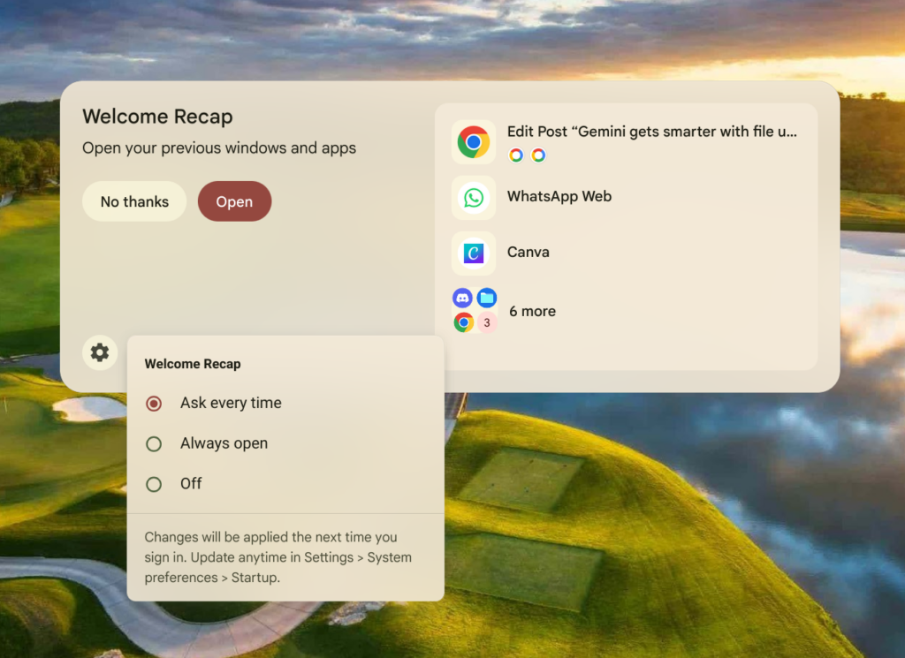

This is going to be a long, meandering article. To make it easier, I've included
the following. Feel free to skip any section that doesn't speak to you 
personally -- the rest should still read coherently on their own.

## Threads worth pulling on

- Why does so much of the world's most enduring technology come from decades 
  ago?
- What happens when the people building a system lose sight of the people it's 
  supposed to serve?
- Why do intelligent people keep producing things they know aren't particularly
  good?
- How do incentives quietly reshape the work we do, the things we value, and 
  the people we become?
- What happens when producing complexity becomes cheaper than exercising 
  judgment?
- Can technology finally adapt to the way humans think, instead of forcing 
  humans to adapt to technology?
- What can an industry like aviation teach us about building systems that work 
  well when people are having bad days?
- How can we ensure that the time saved by technology actually comes back to us?

If you only read one section, I would suggest you Ctrl+F "Back to Aviation" and
then decide if you want to read the rest of this.

## Nostalgia

Why do all of the best things in life seem to be from the '80s? We don't have 
any good movies coming out anymore, good laptops, or cheap phones that don't 
suck (ok that one might be a 2000s thing).

The most useful software in the world is from the '80s, '90s, early aughts too. 

- Emacs (1985) / Vim (1991)
- Linux (1991)
- Python (1991)
- Lua (1993)
- curl (1996)
- Apache (1995) / nginx (2004)
- Javascript (1995)
- SQLite (2000)
- git (2005)
- PostgreSQL (1986, as POSTGRES)

Even Chrome's (2008) lineage stretches back to the '90s, 
through Safari, WebKit, KDE, KHTML.

What changed? Why did coding use to be fun? Even vibe coding, it used to be fun 
before it got stressful and sloppy. Why does the world feel like a pressure 
cooker right now? Everyone is unhappy. Devs are unhappy, users are unhappy, 
hiring managers are unhappy, everyday people are unhappy. **We all know something 
is wrong here but no one knows quite what.**

It's certainly not that it's old. We have much better ways of developing 
software now. _Yet software isn't actually getting better._ What is it that
makes these ancient (in software engineering terms, anyway) systems continue
to endure?

Having recently lost my job due to a funding crisis, I was left with a lot of 
time to think. I am going to share some of these thoughts with you, and you
can decide if you found anything useful to take away.

## The Human Angle

Imagine you are an aeronautical engineer, working for one of the aviation 
greats. Your manager comes up to you and says:

> Build me an aircraft for an airline that can fit 300 passengers, but sometimes
> during vacations, the airline has to handle up to 1000 passengers.

You, a highly skilled engineer, one of the best in the world, could certainly 
come up with some kind of solution. A string of unpowered gliders towed by a 
lead plane, perhaps. But being amongst the best in the world also means you 
might stop to think: _"Why?"_

Who are these people for whom you have to build the aircraft? How many bags do 
they have? Do they have any accessibility needs? Why do they all need to be on 
the same plane?

Those 1000 people are not just numbers on a spreadsheet. Each is a human life we
need to protect, and a person whose experience we want to make stellar.

Your responsible, most correct move, might be to go back to your manager, and 
say, "**No**. I will not build you that aircraft until you tell me more about
this problem."

## The System Design Interview

> Design a system for an online coding platform that handles 3,000 daily active 
> users under normal conditions, but must scale to 100,000 concurrent users 
> during major coding competitions.
> 
> The system must support code submissions, execution against test cases, 
> judging, leaderboards, and live updates.

Yet the above is a perfectly accurate _prompt_, and any LLM will vomit out the 
slop needed to build it.

What the fuck? Admittedly, this is not quite apples-to-apples. Having a 
successful LeetCode submission may not directly be a matter of life-and-death, 
but we could still stop to ask: Who are these people? Where do they come from? 
What are their needs? Why are they on LeetCode? How can we make their 
experience on our site the best? One side of it is of course building the 
scalable architecture. But we know how to build systems that scale! We use other
people's hard-won lessons to do that.

You do not need human engineers to solve the problem as stated. What you want is
a slop machine, that can sneeze out convincing-looking complexity with zero 
signal within it.

**This is what the modern "systems design" interview is optimizing for.** Why? 
Because FAANG is currently churning out slop at an alarming level. Every single
major company you can think of right now has some kind of AI integration, but 
it's completely half-baked. Why? Because the people are no longer the artifact 
of value - the code is. Almost no one is thinking about using AI to improve 
lives - everyone is thinking about using AI because we have to use AI because
we have to maximize "value" for our shareholders.

This is like if in our aviation example above, we were told to optimize for the
people that own the airline, instead of the people that work in it and fly
on it.

Code is _useful_ but the thing we are all ultimately here to do is
make people's lives better in whatever small way. But the 
growth-for-the-sake-of-growth mentality that Silicon Valley and Wall Street 
colluded to normalize makes it incredibly difficult to operate around that
principle. We can suddenly generate thousands of lines of code without first
deciding if the problem deserves thousands of lines of code, or just a skill
file.

**Complexity must be earned.** These are some of the most successful companies on the
planet for a reason - they once built software that was well respected and also 
considered the best on the planet. Facebook connected everyone together. Netflix
made video streaming viable. Amazon basically _solved_ online shopping. 
Apple is, well, Apple. Google accelerated the democratization of knowledge that 
is one of the internet's best qualities.

The problem here is that we rarely build systems this complex at our jobs, and 
they often come with loads of legacy baggage and hard-won requirements and 
simplifications, but we reward candidates for demonstrating how much complexity 
they can design on demand. What does this tell us about our industry? **We seem
to value complexity more than quality engineering decisions.**

## Why?

> Any observed statistical regularity will tend to collapse once pressure is 
> placed upon it for control purposes.
>
> -- Charles Goodhart

I think it boils down to incentives. Everyone is optimizing for the wrong 
incentives. In more pithy terms, the quote above is saying: "When a measure 
becomes a target, it ceases to be a good measure."

* Shareholders want to maximize the profit from their investments.
* Frontier AI labs are building models that are incentivized to be autonomous 
  -- because autonomy is impressive for your shareholders who will then give
  you more money to build AI systems -- but people don't want to be replaced. 
  So these models are built for autonomy, but sold as your "Copilot", "Cowork",
  "Assistant".
* Software and hardware companies are forced to optimize for profit, instead of 
  building good experiences, from where profit naturally follows. How do you 
  optimize for profit? You make more shit to sell. How do you make more shit to 
  sell? You automate the process of making shit.
* Human coders are told, you have "Assistant", "Copilot", "Cowork" now. You 
  should be building more. We need stuff to sell.
* Now the final domino. Hiring is optimized for cheap tests instead of 
  high-quality candidates. In an ideal world, the system design interview would 
  be a way to explore the candidate's thinking, see how they work through a 
  problem, what kind of judgments they make along the way. But it's an industry
  -- you can cram for that stuff in a few weeks on YouTube without ever actually
  building anything. So the person who can unquestioningly produce slop is 
  ranked higher in the hiring market than the person who is asking _why_ we 
  need the slop in the first place.

We might go one step deeper. Software pays a lot because it's important work.
So now we have people forced by circumstances and situations to enter software
even though they don't want to, because they still have to eat.

Everything is a commodity now. Everything must be sold. Your attention, too.
Your friends are no longer your friends - they are your "audience". Your 
software is no longer your software - it's optimized around someone else.

Code used to be the best available signal for the human thought process involved
behind an engineering decision. So we protected it with our lives, treated it
as sacred. _This is no longer the case_. Overnight, with generative AI, code 
became incredibly easy to create.

## Coding like it's 1980

Conversely, why are we still coding like it's 1980?

**Hypothesis**: We found a formula to build successful software once. That 
formula has not changed, but the underlying system it operates on - _the world_,
has changed dramatically.

Why is code so top-to-bottom, left-to-right? It's the C illusion all over again.
We are programming for a machine that no longer exists. Today's software is 
distributed and highly scaled. Even the complexity hiding inside my Arch Linux
desktop would take anyone years to understand. We should stop pretending like 
it's a sequence of steps or some kind of flat algorithm. Our languages assume
sequential execution and organization, and perhaps more damningly, our workflows
assume a one-size-fits-all approach to software engineering. LLMs are very good
at translating text - why can't we translate thoughts between humans?

This was not the future that Alan Kay (Dynabook, Smalltalk), Bill Atkinson 
(HyperCard), or even Terry A. Davis (DolDoc) imagined for us. We can have 
software that fits people! Everyday people should be able to apply technology
to their own problems instead of waiting for Silicon Valley to fix it for them.

We finally have the technical capabilities to build software that fits around 
how people think! Especially with LLMs, which can be used to simulate any 
experience as long as it can be represented as text.

**Tip**: When prototyping UI, try drawing a sketch in Excalidraw and pasting it 
into your coding agent. We no longer have to think in terms of Tailwind classes 
and React components, we can just think about what we want the app to look like!

This is how I built [Next Steps](https://trythursday.org/experiments/next-steps):

Us engineers have always looked down on UI/UX designers - but those guys were 
doing it right all along, and it's our jobs that are at risk now.

We are going to see a new generation of thinkers and designers come into their 
own with AI. These people have always been blocked off from coding because of 
the learning curve involved, but now they can think in whatever way feels right,
and let the AI take care of the implementation.

I am not saying that this is about whiteboarding or UI mockups. I am saying that
for far too long, we have been trying to force human thinking into something a
computer can understand -- for the first time, a human can think in their own
way and the computer gets what they _mean_. 

## Slop and complexity

I think I was asking the wrong questions at the beginning of this article.
It's not that good stuff used to come out of the 80s - it's that computers and
technology were restricted enough, and people had so little time, that every
ounce of human effort spent on a problem meant something.

Most of the examples I mentioned started out as a tiny set of useful 
abstractions that one person started building to solve a personal problem. Then
others found them useful, and they endured. We have modern examples of excellent
software too, like VSCode, but I think they succeeded in spite of what modern
software engineering has become, not because of it.

Humans have to be efficient about what we do because our cognition is the most
precious resource in this optimization problem. That might simply mean writing
"BROKEN" in the middle of your code so you can forget about it for a bit and 
go to lunch.

The thing is, there is not much difference between human slop and AI slop, and
there's nothing bad about slop by itself. Slop is just complexity without 
thinking put into it. The problem with AI slop is that it can create a 
convincing-looking system, and a massive one at that, but the whole thing is
imagined - it has never once met implementation with reality.

### Bun is Fine, actually

Hopefully most of the people reading this remember the Bun rewrite from earlier 
this year. A refresher: Bun rewrote their entire codebase from Zig into Rust 
using AI in about four months, with Jarred Sumner claiming the first experiments
took about nine days.

I remember a lot of people hemming and hawing and dooming about the AI rewrite. 
I remember even personally thinking, "wow, bun was interesting, but i may never 
use it again, it's slop now", because of my own experiences with slop. Then
a couple of weeks ago, Deno, my preferred runtime, announced that they were 
joining Cloudflare, and Deno itself would be sunset.

So I had to try Bun. I wasn't going back to Node.js. Guess what? It's just 
fucking fine. They had a concrete goal -- Rewrite it in Rust. They had a stellar
test suite. The "well-formed questions" were already there. From there, the
translation was mechanical. Rust is an especially great target for LLMs, because
it's so well-documented and the compiler errors point us to relevant info and
fixes.

Bun works great. I use it for everything now. I wrote my 
[reproducible desktop configuration](https://github.com/xyzshantaram/dots) in 
Bun, with AI. Most of the tooling and projects in Thursday are written in Bun,
too.

    
Some specific Bun features I enjoy

- Built-in Markdown compiler
- Built-in test runner
- Built-in TypeScript compiler
- Built-in shell-scripting tools
- Built-in superfast SQLite interface

It's basically replaced whatever I was previously using Deno+`zx` for, which 
themselves replaced `bash`+`python` - now I can write everything in TypeScript.
This site you're reading now is compiled/served by Bun, too.

## Vibe coding used to be fun

I vibe coded for a month straight after I lost my job. I wanted to build the 
perfect coding agent around DeepSeek Harness. I built a ticket kernel+board, a 
gate system that removed and added tools from the model as needed, tons of 
look-and-feel improvements to DSH. I thought I was building stuff for myself,
it would be fun, but I was completely miserable.

It didn't use to be this way. Why was it that I was able to complete a 17,000
line refactor of our core libraries at my old team in just one week using 
GPT-4.1? The refactor survived through the untimely demise of the org.

I remember the response to GPT-4.1. People said it was too careful, too slow, 
etc. I was delighted with GPT-4.1 though. I think OpenAI had something fucking
great at the time, but "conventional wisdom" (which is usually neither 
conventional nor wise) and how we were already being conditioned to think about
AI, prevented it from becoming something great.

The thing is, early coding agents were good at one thing and one thing only -
take this text, make it into some other text. That's incredibly powerful already!
Suddenly you could think in your best language, still being a careful coder, but
you could automate the mechanical parts of coding away and keep the fun parts 
for yourself.

This led to a feedback loop. We became more and more willing to trust our agents,
and more and more lazy about putting in the high-quality thinking that goes 
behind a stellar product.

_LLMs are still "just" fancy autocomplete. **And that's fine.**_

I learned something important after writing thousands of lines of AI slop. The 
slop was never the problem. I've had sloppy code all my life. The difference was
that the slop was well-understood, and able to be reasoned about, and if I ever 
needed to excise it, I knew where to start. But these were scripts and systems
and services that were running my life and they were slop, and I was fine with
that.

### Guide coding

Another question I kept hitting: Why were some people able to create cool shit
that _felt_ good with AI? Why was my vibe-coded software always falling short?
I knew I could do it properly and get the perfect result, but that would be too
slow. Somehow, these guys were able to do stuff fast _and_ good.

[Someone vibe coded a port of GTA V into the browser](https://kotaku.com/we-might-be-cooked-as-these-vibe-coded-web-browser-ports-of-halo-the-simpsons-hit-and-run-and-gta-vice-city-seem-to-work-perfectly-2000743300). 
Someone else clean-room reverse engineered the entire Adobe suite and 
[released it for free, open source](https://getartcraft.com/apps). Clearly AI is
letting _some_ people get stuff done! It's enabling _some_ kind of thinking!

I suspect that these people understand AI is just another tool in their belt,
and they know when to reach for it vs when to sit down and do some thinking/
whiteboarding/what-have-you.

> “What do you get if you multiply six by nine?"  
> "Six by nine. Forty two."  
> "That's it. That's all there is."  
> "I always thought something was fundamentally wrong with the universe.”  
>
> -- Douglas Adams, *The Hitchhiker's Guide to the Galaxy*

Generative AI is great for coming up with plausible answers to questions.
However, the question itself must be well-formed - then we can narrow down the
search space by building prototypes to find out what feels right.

The people who are excelling with AI understand that there is more than one way 
to approach any problem. You cannot be absolutist and you have to be willing to 
step back and throw stuff away.

Hence, guide coding. The developer is back in the hot seat. They are not giving 
a prompt to the LLM to build something - they are _using_ the LLM as a tool to
figure out what they actually want. Then they apply the relevant amount of 
autonomy to solve that concrete problem. Rinse and repeat.

## The Emperor Has No Clothes

It is important to realise and then remember, that frontier AI labs are starting
to be experiments in making AI that can take over an entire human life and do
every single thing a human is able to do.

For most of your day-to-day work, you do not need these massive, ugly, expensive,
proprietary behemoths. It's a work of art, sure, but I'd rather have an office
calendar than the Mona Lisa when I'm working.

For most of your day-to-day work you do not need that stuff. This entire blog 
site, and all Thursday experiments, were guide coded using DeepSeek V4.1 Flash.
I spent less than $15 this month on AI, and I'm coming up on 3 billion tokens.

Vote with your wallet. Support open models and open source. 

The thing is, frontier labs are actively discouraging people from trying AI at 
home by pretending that they are the only ones who can do it. Really we should 
put cheap AI into every laptop and phone, and make sure as many people as 
possible can use it with no strings attached. The frontier is almost home -
I suspect something like Qwen3.8 Flash Next is already enough for a lot of
agentic coding work, because the agent should be a multiplier of your own force,
not something that steals your job from under you.

### Instinct

An AI service I recently started using is Instinct - a personal assistant
that lives in your WhatsApp. This is the first time that I've found a generative
AI assistant to be useful, simply because it's there when you need it, then it
gets out of the way. This is what I wanted all along with ChatGPT or Gemini.
The feature I use it for the most is simply setting reminders. The fact that 
it's able to ping me on WhatsApp, a place where I already spend most of my day
talking to friends and family, is a game changer for stuff like taking my
medication, following up on clients, getting errands done. I also tried it on
an online shopping research expedition trying to find a toy from my childhood.
This one was less successful, but it at least got me some good leads. _This is 
what AI should feel like!_

## There is Hope

We all know FAANG is producing slop right now. Or, more defensibly, the default 
output mode is slop. FAANG is a system composed of several thousands or dozens 
of thousands of people. It would be patently untrue and incredibly unfair to say
they are all slop coders. 

There are still people who are powering through, cutting through the slop, and 
continuing to build for people, even at Facebook or Google. 

Facebook is the only American lab that makes an open frontier-level model. 

Google is still making delightful UX. I daily drive a Pixel 9a on the stock
Google ROM. Disregarding the privacy concerns for a second and the adware
doomerism, this is the most delightful phone experience I have had. I bought
a Chromebook as a second laptop to take on vacation, watch movies in bed with,
draw on. It's the most delightful computer I've owned.

Every time I have a cool idea I find something similar someone at
Google is researching (their [widget vibe-coding system](https://techcrunch.com/2026/05/12/googles-create-my-widget-feature-will-let-you-vibe-code-your-own-widgets/) in 
Android 17, and more recently the [Elephant-Goldfish model](https://egm.dev/)). 

We cannot reject all of FAANG as bad, it's just that most FAANG engineers are 
highly intelligent people forced to produce slop as a result of misaligned
incentives in the systems they operate within.

## Back to Aviation

Why do I keep coming back to aviation in this article? I think it's the safest 
industry in the world for a reason, and ours could learn some stuff from it.

They understand that while being extra safe has a cost, it's well worth not 
being wracked by guilt and fear. It's also the framework that helped me 
understand all of this. Let's look at the situation through some aviation lenses.

### Crew Resource Management

The AI is one of the many resources in your crew, just like cabin crew or your
first officer in an aircraft. Your family, friends, coworkers, are all resources
too -- you can learn from them and their experiences to build a better life for 
yourself and them.

Everyone on a crew does what they do best, and in exchange, we get thousands of
safe flights every day. The AI is good at transforming text, writing efficient
bash-isms, and writing exploratory code in Python/TypeScript. You are good at 
thinking. How can you use the AI as a tool to enable your own thinking?

### Human factors engineering

Aviation tries to mitigate the human factors in a problem. Human cognition is
a resource in the optimization problem. Tedious tasks that computers do better
anyway, like maintaining the aircraft's heading, pitch and roll, are automated
so the humans can focus on what matters -- a safe flight from takeoff through
landing. The human's "workload" -- the amount of things they have to keep track
of -- needs to be minimized so they can keep focusing on the things that matter.

Anything safety-critical goes in a standard operating procedure or checklist. 
Enable the human to forget, so they can focus when it matters. Everything is
designed to minimize human friction.

It's not that pilots don't make mistakes. It's that when they do, there are 
systems to ensure their and the passengers' continued safety. Almost as 
important is the fact that there's a blame-free environment for operators and
industry members to report mistakes or misbehaviour without fear of reprisal.

Can we build systems like these for ourselves?

### Being data-driven

With the Internet and AI, we can build a hyperfast, hyperlocal feedback loop to
create software tailored for specific people and their needs. Aviation engineers
love data. Everything has telemetry, and even in the case of a disastrous crash,
an effort is made to save the data around the flight so that whatever went wrong
can be stopped from happening next time.

We, too, can be big data about little problems.

### Go-arounds and safety margins

There is no shame in a go-around. Aviation is built around harm reduction - 
operators have well-defined rest and duty periods, and absolute freedom to stop
a flight if they simply just have a bad feeling about something. We need more
of that culture in engineering.

Interrupt your coding agent. Stop it when you don't understand what's going on.
Don't be afraid to throw away code that isn't doing its job, or could do it
better. Don't be afraid to change directions based on your evolving 
understanding of a situation and its unique needs.

### Defense in depth / The Swiss Cheese Model

Aviation is all about multiple overlapping safeguards. Assume that humans _will_
have bad days, then ask: how can we make that safer? How can we make technology
that's easy to understand and build muscle memory around? How can we 
deliberately break their focus away from less important things in case something 
important is going poorly?

We can import this into our coding agents too. You should be able to verify
something personally that can check the AI. The AI should be able to check you.
The verifier should be able to be inspected by the AI too. By putting all these
things into a system that work with each other, we can make every day coding
safer and more fun.

### Standard Operating Procedures

Let humans forget. From one single base mnemonic (Aviate, Navigate, 
Communicate), aviators can derive everything they need to know to keep an 
aircraft in the air then land it safely.

Anything safety critical is a memory item. Everything else can go in a standard
operating procedure or a checklist. Let humans forget about stuff so they
can focus on what's important.

### In short

Build systems that work well when humans are having bad days.

## Healing

These all seem like massive, insurmountable problems. But healing is simple -
it starts now. Build for yourself, build for your people. On a flight, one of 
the most important things we are told during a safety briefing is that in the
event of pressure loss in the cabin, we are to secure our own oxygen masks 
before helping others with theirs.

In practice, this means that healing from these misalignments can start today,
now, where you are. Build a better system for your own work. Maybe it helps your
coworkers. Maybe that helps the users of your product. Maybe that helps them in
their lives. A single change for yourself can be the start of a ripple effect 
that affects hundreds of people positively.

Be thoughtful about what you're building. Ask: is this complexity needed right 
now?

Put your tokens where your mouth is. Pledge to building software for people.

<reformed-vibe-coders
      repo="trythursday/reformed-vibe-coders"
      endpoint="https://reformed-vibe-coders.me-5db.workers.dev/api/pledge">
</reformed-vibe-coders>

Tell your friends: <https://reform.trythursday.org>.

### The Thursday skill

I have tried to encode some of these principles into the Thursday AI skill for 
your coding agent. It could have come in many forms. But the humble skill file,
I decided, would be the best way to unlock my own force with a coding agent, 
and the best thing I could make that would fit into a lot of people's workflows
and start generating data.

It's built around situational awareness and progressive disclosure. The one 
thing you have to remember - **Type `/thursday` at any time to start a 
Thursday session.** Then vibe code like normal.

To try it (requires node 24+ or can bootstrap its own Bun), paste in your
agent of choice:

> I want to try the Thursday skill from https://github.com/trythursday/thursday.

By default it sets up at `/tmp` so you can try it out for a small task before
you decide you want to commit to it.

I would love to know what you think - type `/thfeedback` at any time to leave 
feedback.

## Afterword

My friend likes to say that now, with AI, humans' job is to relax and automate 
away the tedious parts of life so they can focus on maximizing fun.

I would like to qualify that, since nothing is absolute - this can only happen 
if we revisit our incentives and the systems that we belong to, and make sure 
that the time AI frees up comes back to us.
